# Diagrama de classes proposto

Este diagrama representa a evolução planejada do projeto a partir do modelo atual. É uma proposta de domínio e arquitetura; ainda não corresponde a classes implementadas.

```mermaid
classDiagram
    class SistemaRpg {
        +int id
        +String nome
        +String descricao
    }

    class RegraSistema {
        +int id
        +Integer limitePontos
        +Integer nivelMinimo
        +Integer nivelMaximo
    }

    class DefinicaoAtributo {
        +int id
        +String codigo
        +String nome
        +int valorMinimo
        +int valorMaximo
        +int ordem
    }

    class OpcaoSistema {
        <<abstract>>
        +int id
        +String nome
        +String descricao
    }

    class DefinicaoItem {
        +int id
        +String categoria
        +String definicaoPropriedadesJson
    }

    class Item {
        +String categoria
        +String propriedadesJson
    }

    class Arma {
        +String valorAtaque
    }

    class Armadura {
        +String valorDefesa
    }

    class Escudo {
        +String valorDefesa
    }

    class Raca {
        +String habilidade
    }

    class Classe {
    }

    class Divindade {
    }

    class Pericia {
    }

    class Feitico {
    }

    class Preset {
        +int id
        +String nome
        +String descricao
    }

    class PresetItem {
        +int id
        +int quantidade
        +String propriedadesPersonalizadas
    }

    class Personagem {
        +int id
        +String nome
        +int nivel
        +Integer vidaAtual
        +Integer vidaMaxima
    }

    class AtributoPersonagem {
        +int id
        +String codigoAtributo
        +int valor
    }

    class Inventario {
        +int id
        +int quantidade
    }

    class WebApp {
        <<cliente>>
    }

    class AndroidApp {
        <<cliente>>
    }

    class SistemaController {
        +listar()
        +obter(id)
        +criar(sistema)
        +atualizar(id, sistema)
        +excluir(id)
    }

    class PresetController {
        +listarPorSistema(sistemaId)
        +criar(preset)
        +atualizar(id, preset)
        +excluir(id)
    }

    class PersonagemController {
        +listar()
        +obter(id)
        +salvar(personagem)
        +atualizar(id, personagem)
        +deletar(id)
    }

    class BackupController {
        +exportarSistema(sistemaId)
        +importarSistema(arquivoJson)
    }

    class SistemaDAO
    class PresetDAO
    class PersonagemDAO
    class InventarioDAO
    class BackupService {
        +exportarSistema(sistemaId)
        +validarEImportar(arquivoJson)
    }

    class BackupSistemaJson {
        +int versaoFormato
        +SistemaRpg sistema
        +RegraSistema regras
        +List atributos
        +List catalogos
        +List presets
    }

    OpcaoSistema <|-- Item
    Item <|-- Arma
    Item <|-- Armadura
    Item <|-- Escudo
    OpcaoSistema <|-- Raca
    OpcaoSistema <|-- Classe
    OpcaoSistema <|-- Divindade
    OpcaoSistema <|-- Pericia
    OpcaoSistema <|-- Feitico

    SistemaRpg "1" *-- "1" RegraSistema : regras
    SistemaRpg "1" *-- "1..*" DefinicaoAtributo : define
    SistemaRpg "1" *-- "0..*" DefinicaoItem : configura itens
    SistemaRpg "1" o-- "0..*" OpcaoSistema : catalogos
    DefinicaoItem "1" <-- "0..*" Item : tipo
    SistemaRpg "1" *-- "0..*" Preset : possui
    Preset "1" *-- "0..*" PresetItem : inclui
    PresetItem "*" --> "1" Item : item

    SistemaRpg "1" <-- "0..*" Personagem : sistema
    Personagem "1" *-- "0..*" AtributoPersonagem : valores
    AtributoPersonagem "*" --> "1" DefinicaoAtributo : atributo
    Personagem "1" --> "0..*" Inventario : possui
    Inventario "*" --> "1" Item : referencia

    WebApp --> SistemaController : REST/JSON
    WebApp --> PresetController : REST/JSON
    WebApp --> PersonagemController : REST/JSON
    WebApp --> BackupController : download/upload JSON
    AndroidApp --> SistemaController : REST/JSON
    AndroidApp --> PresetController : REST/JSON
    AndroidApp --> PersonagemController : REST/JSON
    AndroidApp --> BackupController : download/upload JSON

    SistemaController --> SistemaDAO
    PresetController --> PresetDAO
    PersonagemController --> PersonagemDAO
    PersonagemController --> InventarioDAO
    BackupController --> BackupService
    BackupService --> SistemaDAO
    BackupService --> PresetDAO
    BackupService ..> BackupSistemaJson : serializa/valida
```

## Relação com o modelo atual

- `SistemaRpg` passa a agrupar regras, definições de atributos e itens, catálogos e presets. O sistema padrão pode reproduzir as opções atualmente cadastradas; novos sistemas podem ser criados pela aplicação.
- `DefinicaoAtributo` e `AtributoPersonagem` substituem a dependência exclusiva dos cinco atributos fixos (`forca`, `inteligencia`, `destreza`, `sabedoria` e `carisma`). Assim, cada sistema pode definir sua própria lista e seus limites.
- `RegraSistema` guarda configurações como orçamento de pontos e limites de nível. `DefinicaoItem` permite que cada sistema defina categorias e propriedades configuráveis para seus itens, enquanto `propriedadesJson` guarda os valores de cada item. `Item` genérico permite cadastrar categorias novas sem criar uma classe Java por categoria; os tipos especializados atuais podem continuar como conveniências do sistema padrão.
- `Raca`, `Classe`, `Divindade`, `Pericia` e `Feitico` continuam representando opções do domínio, mas passam a pertencer a um sistema. Armas, armaduras e escudos permanecem tipos especializados de `Item`.
- `Preset` pertence a um sistema e relaciona seus itens por `PresetItem`. Um preset pode incluir quantidades e ajustes sem alterar o item do catálogo.
- `Personagem` pertence a um sistema e passa a registrar nível e vida atual/máxima. O inventário referencia itens do catálogo do mesmo sistema.
- Web e Android são clientes da mesma API REST; regras e persistência permanecem no servidor, evitando implementações diferentes por plataforma.
- O backup JSON de sistema inclui regras, atributos, catálogos e presets. `versaoFormato` permite validar e evoluir o formato. Neste escopo, a exportação não inclui personagens nem inventários.
- Como os dados atuais são apenas de teste e podem ser descartados, a implementação pode criar o esquema novo diretamente, sem migração dos registros existentes.

As cardinalidades e a separação entre `OpcaoSistema`, `DefinicaoItem` e `Item` são uma proposta para orientar a implementação; podem ser ajustadas antes de codificar conforme os primeiros sistemas que serão suportados. A vida atual/máxima e o nível são valores da ficha para manejo manual; regras para cálculo automático de vida ficam fora deste escopo inicial.
